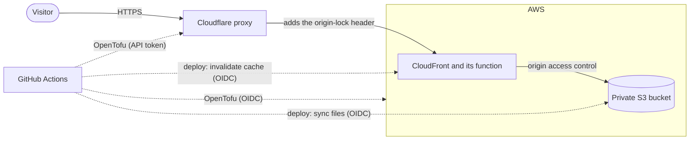

# sebastiansuarez.dev

Source for [sebastiansuarez.dev](https://sebastiansuarez.dev), the portfolio of Sebastian Suarez, backend lead and architect. It is a static site with three pages: the portfolio, a [résumé](https://sebastiansuarez.dev/resume/), and [How this site works](https://sebastiansuarez.dev/how-it-works/), which walks through the pipeline and infrastructure below with diagrams.

## How it is served



- Cloudflare proxies `sebastiansuarez.dev` and `www` with SSL Full (strict), and adds a secret header to the HTTPS requests it sends to CloudFront.
- A CloudFront Function answers 403 to any request without that header, so the site is only reachable through Cloudflare. It also redirects `www` to the apex and serves `/dir` from `/dir/index.html`.
- CloudFront reads the files from a private S3 bucket through origin access control. A missing path gets the 404 page with status 404.
- GitHub Actions reaches AWS through OIDC and short-lived role credentials, so GitHub stores no AWS keys.

## Stack

- [Astro](https://astro.build) 7 with static output.
- React 19 components, rendered at build time only. No React code runs in the browser.
- Tailwind CSS 4 through its Vite plugin, plus plain CSS in `src/styles/`. System font stack, no web fonts.
- Scroll animations in CSS (`animation-timeline`), with a GSAP fallback for browsers that lack it.
- Diagrams are SVG, described as data in `src/components/diagram/` and drawn by `Diagram.tsx`.
- Infrastructure in OpenTofu: S3, CloudFront, ACM and IAM on AWS; DNS and a request header rule on Cloudflare.

## Layout

```text
src/
  pages/        index, resume, how-it-works, 404
  components/   React components; diagram/ holds the SVG diagrams
  data/         the text and links on the pages (see "Editing content")
  layouts/      Base.astro, the shared page shell
  scripts/      small browser scripts, such as the accordion, project tabs and diagram reveal
  styles/       global.css, resume.css
public/         files served as they are
infra/          OpenTofu stacks for the site, the CI roles and their bootstrap
scripts/        deploy.sh (S3 sync and CloudFront invalidation), check-release.mjs
docs/           the plan and review log of each larger change
.github/        CI, Deploy and Infra workflows; Dependabot
```

## Develop

Node 24 (see `.nvmrc`).

```bash
npm ci
npm run dev             # http://localhost:4321
npm run build           # writes dist/
npm run preview         # serves dist/
npm run check:release   # after a build: fails if a page still has a placeholder link
```

Use root-absolute links (`/resume/`, not `resume/`). CloudFront serves `/dir` without redirecting to `/dir/`, and the 404 page is served at whatever path was requested, so relative links would resolve against the wrong folder.

## Editing content

The words on the pages live in `src/data/`:

| File | What |
| --- | --- |
| `site.ts` | Name, role, contact links, page description |
| `cv.ts` | The résumé page. It follows the PDF résumé word for word; keep the two in step |
| `projects.ts` | Project cards |
| `clientWork.ts` | Client work tabs and their charts |
| `employers.ts` | Employer strip |
| `capabilities.ts` | Capabilities accordion |
| `manifesto.ts` | Manifesto paragraph |
| `howItWorks.ts` | The How this site works page. Update `setupCheckedOn` whenever its claims are checked again |

## Deploy

- Pull request: `Build` builds the site and `Terraform plan` plans the infrastructure. Both must pass, and `main` only changes through pull requests.
- Merge to `main`: when anything outside `infra/` changed, `Deploy` builds the site, syncs `dist/` to S3 (hashed assets cached for a year, everything else revalidated on each request) and invalidates CloudFront. When `infra/` changed, `Infra` applies the CI roles (`infra/iam/`) first, then the site stack (`infra/`).

The roles and their permissions boundary, the origin lock, secret rotation and recovery steps are in [infra/README.md](infra/README.md).
